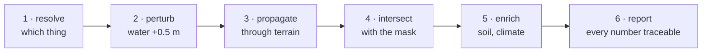
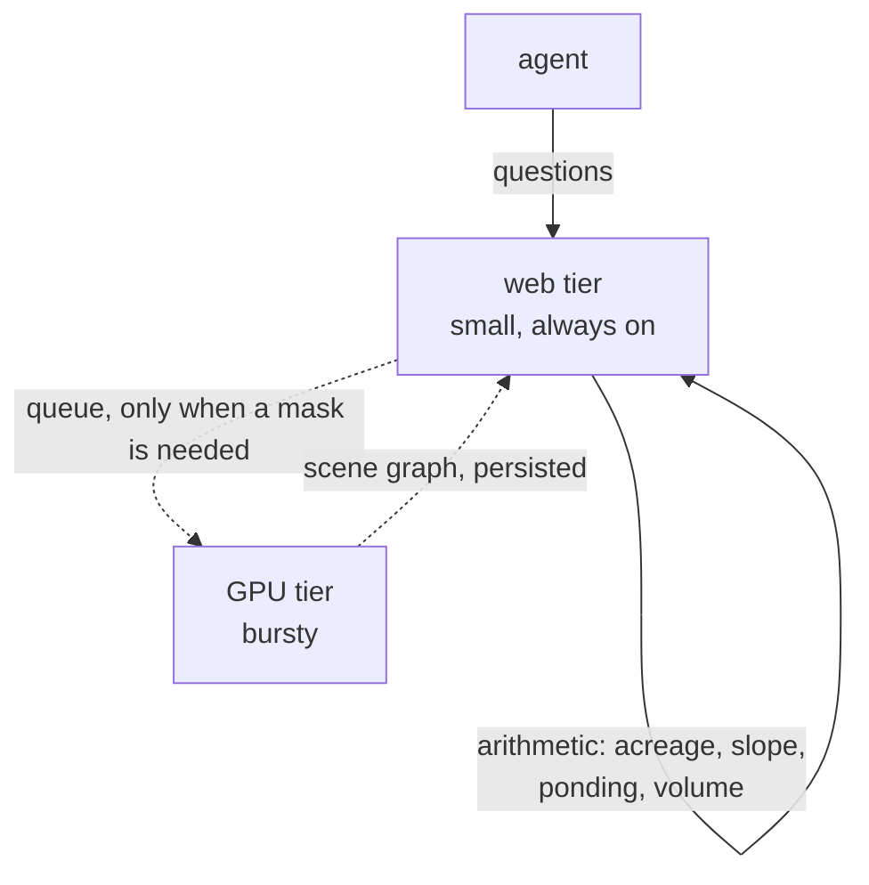

# Wiring this into an agent

If you are building an agent that answers questions about land, this page is the
shortest path from "I have a parcel and a question" to "here is a number the
user can check."

Works with LangGraph, LangChain, the OpenAI/Anthropic tool APIs, or a plain
function dispatcher. The pattern matters more than the framework.

---

## The one rule

**Never give the agent the raster.**

Asking a model to find something in pixels scores **4.67 out of 100**. Asking it
to reason about positions given in text scores **~90**. Hand an agent an image
and it will eventually try the first path, and it will be confidently wrong one
time in twenty — which is worse than failing outright, because nothing flags it.

The agent gets a **scene graph**: a table of what is on the parcel, where, and
how big, all measured beforehand by counting pixels.

---

## Step 1 — build the scene once

```python
from pestren_geo import GridSpec, mask_area

grid = GridSpec.from_bounds(parcel_bounds_m, gsd=0.6, crs="EPSG:5070")
mask = your_segmenter(imagery, grid)        # 6-class labels
blobs = instances(mask, grid)               # connected components + measurement

scene = {
    "parcel_id": parcel_id,
    "imagery_date": "2024-06-14",
    "elevation_date": "2021-04-02",
    "grid": grid.describe(),
    "blobs": [
        {"id": 1, "class": "tree_windbreak", "acres": 0.81,
         "centroid_pct": [15, 12], "quadrant": "NW"},
        {"id": 2, "class": "tree_windbreak", "acres": 1.24,
         "centroid_pct": [80, 60], "quadrant": "SE"},
        {"id": 3, "class": "ditch_canal", "acres": 0.42,
         "centroid_pct": [50, 4],  "quadrant": "N", "length_m": 340},
    ],
}
```

That is roughly 50–200 KB of JSON for a typical parcel. Small enough to keep in
the agent's state for the whole conversation.

**The dates are not decoration.** The cache key is `parcel + imagery date +
elevation date`. Without them you cannot tell whether a cached answer still
applies, and the entire point of this library is knowing when a number went
stale.

---

## Step 2 — put it in state, not in every tool

This is where most implementations go wrong. Tools that each fetch their own data
turn a six-question conversation into six segmentation runs.

```python
from typing import TypedDict

class ParcelState(TypedDict):
    parcel_id: str
    scene: dict | None      # ← loaded once, lives here
    facts: list[dict]       # Measurements accumulated, for citation
    answer: str | None

def load_scene(state: ParcelState) -> ParcelState:
    if state.get("scene"):
        return state                     # already here, no network, no GPU
    state["scene"] = build_scene(state["parcel_id"])
    return state
```

Every tool after this **reads `state["scene"]`**. Only genuinely new computation
— a flood simulation, a second flight year — touches the expensive path again.

---

## Step 3 — narrow, typed tools

Not `analyse_parcel(image)`. That is the 4.67 task wearing a friendly name.

| Tool | Returns | Touches a model? |
|---|---|---|
| `select(expression)` | which blob the words mean | yes — reads the table, never the image |
| `measure(blob_ids)` | acres, with provenance | no |
| `farmable_acres()` | parcel minus non-farmable classes | no |
| `flood_from(blob_id, rise_m)` | inundated area + what is under it | no |
| `describe()` | prose about what is visible | yes — the one task scoring 88 |

Four of the five never touch a model. That ratio is the design, not an accident.

### Example tool

```python
from langchain_core.tools import tool

@tool
def farmable_acres(state: ParcelState) -> dict:
    """Acres of this parcel that can actually be cropped."""
    scene = state["scene"]
    non_farmable = sum(b["acres"] for b in scene["blobs"]
                       if b["class"] != "cropped")
    m = Measurement(
        value=scene["parcel_acres"] - non_farmable,
        unit="acre", method="pixel_count",
        gsd_m=scene["grid"]["gsd_m"],
        support_scale_m=scene["grid"]["support_scale_m"],
        crs=scene["grid"]["crs"],
    )
    return m.to_dict()
```

**It returns a `Measurement`, not a sentence.** That is what makes the trace
useful: you see `{"value": 138.2, "method": "pixel_count", "gsd_m": 0.6}` rather
than "the model said about 138 acres." When an answer is wrong, you can see
*which* measurement was wrong and how it was made.

---

## Step 4 — resolving "the trees on the top left"

```python
@tool
def select(expression: str, state: ParcelState) -> dict:
    """Pick the blob a phrase refers to. Reads the table, never the image."""
    candidates = state["scene"]["blobs"]
    # the model sees ONLY this text
    return llm.choose(expression, candidates)
```

The model is handed:

```
#1 tree_windbreak  0.81 ac  NW  15% from left, 12% from top
#2 tree_windbreak  1.24 ac  SE  80% from left, 60% from top
#3 ditch_canal     0.42 ac  N   50% from left,  4% from top
```

and asked which row. 15%/12% is plainly the top left. **It is reading, not
searching** — which is why this works at ~90 rather than 4.67.

**When several rows fit, return all of them and ask.** Guessing to seem helpful
is how a confident wrong answer reaches someone making a financial decision.

---

## Step 5 — verify before answering

Add a final node that checks **every numeral in the answer resolves to a fact in
`state["facts"]`**. Drop sentences that do not.

This is the step that makes the output citable. Without it, a model will happily
round 138.2 to "about 140" or invent a plausible figure in a summary sentence,
and nothing downstream can tell.

---

## Follow-up questions all have the same shape

Once you see it, every interesting question decomposes the same way:



*"If ditch 3 floods, what gets damaged?"*

1. `select("ditch 3")` → blob #3
2. raise the water level 0.5 m
3. fill the terrain outward — every connected cell below that level
4. intersect with the mask — how much is `cropped`?
5. soil survey → how long it stays wet
6. **"A 0.5 m rise spreads over 4.2 acres, 3.8 of them planted. The soil is
   somewhat poorly drained, so it holds water five to ten days."**

Steps 1 and 6 use a language model. **Steps 2–5 are arithmetic.**

---

## What to do when you do not know

Three answers that are better than a guess, and should be wired in explicitly:

- **"That is outside the classes I measure."** A septic tank is buried; a well
  head is 30 cm across. See [`CLASSES.md`](CLASSES.md) — some things belong to a
  registry, not to imagery.
- **"Several things match — which did you mean?"**
- **"My imagery is from 2024-06 and your question is about last month."**

A system that reports its own limits is the only kind whose other answers can be
used without re-checking them.

---

## Hosting the expensive half

Segmentation wants a GPU; everything else is arithmetic and runs anywhere. A
shape that works:



Two properties worth preserving: the web tier **queues** rather than blocks, and
when the GPU is unavailable it still answers everything in the arithmetic path —
which is most real questions.

Expose the GPU through a tunnel with authentication. Do not port-forward a box
with a model server on it.
