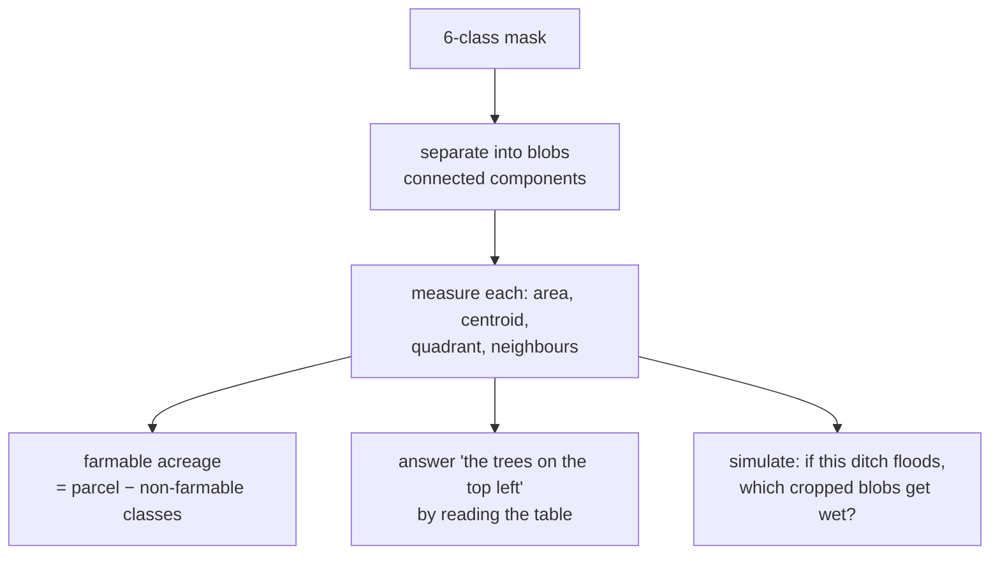

# What the model labels, and why

The class set is not a list of interesting things. It is the answer to one
question, derived backwards from the arithmetic.

**"How many acres of this parcel can actually be farmed?"**

Somebody buys 160 acres but cannot plant 160. A track crosses it. A drainage
ditch takes a strip. There is a treeline on the north edge, a barn, and a corner
of gravel that has never grown anything. The number a bank lends against is what
is *left*.

So every class earns its place by **changing that number**.

---

## The six

| Class | In plain words | Why it exists | Typical width |
|---|---|---|---|
| `cropped` | The growing crop | The thing being measured — everything else is subtracted from the parcel to leave this | — |
| `farm_road` | Tracks the tractor drives on | Permanently unplantable. On a long thin parcel, 2–4% of the total | 3–5 m |
| `ditch_canal` | Irrigation or drainage channel plus banks | Unplantable, **and** it decides where water goes — which drives most follow-up questions | 2–4 m |
| `tree_windbreak` | A planted line of trees blocking wind | Unplantable but *valuable* rather than waste: it shelters the crop. Counting it as lost acres without saying why would mislead | 5–20 m |
| `building_yard` | Barn, house, equipment yard, grain bins | Unplantable, and usually assessed differently for tax | — |
| `bare_other` | Bare dirt, gravel, scrub — anything not growing | The catch-all. Every classifier needs one, or it must invent a wrong label for things it has never seen | — |

### The rule behind the list

A class that does not change what you can farm does not belong, however visible
it is from above.

That is why there is **no "corn vs soybeans" class.** It is a genuinely
interesting distinction, it changes nothing about acreage, and the USDA Cropland
Data Layer already answers it for free. Adding it would cost labelling effort and
buy nothing.

---

## Honest limitations

Anyone using this should know these before trusting a number.

**`cropped` is a weak label.** Nobody traced it by hand. It is generated as "any
vegetated pixel inside the chip that falls outside every traced polygon" — so a
weedy verge reads as crop. It is eroded back from the traced edges to limit the
damage. This is a significant part of why honest accuracy sits at 0.368.

**`bare_other` is the worst class**, at 0.089 IoU. That is what happens to a
catch-all: it contains several genuinely different things that look nothing
alike, so the model cannot form a coherent idea of it.

**The label set is imbalanced.** From 171 hand-traced polygons:

| Class | Polygons |
|---|---|
| `farm_road` | 56 |
| `tree_windbreak` | 35 |
| `building_yard` | 35 |
| `bare_other` | 29 |
| **`ditch_canal`** | **16** |

`ditch_canal` scores 0.157 IoU, and 16 training polygons is most of the reason.
That is a data problem, not a model problem, and no architecture change fixes it.

---

## Classes we are asked for, and what each would take

Three requests come up constantly. **Two of them are better answered from records
than from pixels**, and saying so is more useful than pretending otherwise.

### Septic tank

**Usually invisible from above — it is buried.** What is sometimes visible is the
drain field, as a faint rectangle of differently-stressed vegetation, and only in
certain seasons and soils.

The authoritative source is a **county septic permit**, not an image. This is a
clean example of the split: physical truth is measured from the ground, legal and
administrative truth comes from a registry. Asking imagery for it is asking the
wrong instrument.

> **Status:** not planned as a pixel class. Route to the permit record.

### Well head

Some are visible — a pump house, a pad, a pressure tank. Many are a 30 cm pipe,
below what 0.6 m imagery resolves reliably.

And the authoritative source already exists: most states publish a **well
registry**. A registry tells you status, depth, operator and date. A detector
finds a bright rectangle and cannot tell a producing well from one plugged in
1958 — which is the only distinction that matters.

> **Status:** not planned as a pixel class. Route to the state well registry.

### Culvert

A pipe where a ditch crosses under a track. **Visible only at its mouth**, a
metre or so across, frequently shadowed or vegetated over.

This one is genuinely a candidate, but as a *relational* feature rather than a
class: a culvert is "where a `ditch_canal` blob meets a `farm_road` blob." That
intersection is computable from the mask you already have, with no new labels at
all.

> **Status:** planned as a derived feature in `change`/`terrain`, not a trained
> class.

---

## Classes that are realistic to add

These are plausible pixel classes — visible at 0.6 m, large enough to resolve,
and they change a number somebody cares about.

| Candidate | Changes what | What it needs | Feasible at 0.6 m |
|---|---|---|---|
| `water_body` | Acreage, storage, flood exposure | ~40 polygons; NDWI already separates most of it | Yes — ponds are large |
| `center_pivot` | Irrigated vs dryland acreage, water rights | ~40 polygons; the circular form is highly distinctive | Yes |
| `solar_array` | Land-use conversion, lease value | ~40 polygons; strong regular texture | Yes |
| `grain_bin` | Currently absorbed into `building_yard` | ~40 polygons; small but high-contrast | Marginal |
| `fence_line` | Boundary evidence, grazing units | Very hard — often one pixel wide, frequently occluded | Marginal |
| `livestock_pen` | Nutrient management, permitting | ~40 polygons | Yes |

### What "adding a class" actually costs

1. **40–60 traced polygons spread across at least 8 sites.** Spread matters more
   than volume — with fewer than 8 sites, five-fold blocked cross-validation has
   folds containing no examples at all, and the reported IoU is meaningless.
   `ditch_canal` at 16 polygons across 7 sites is the cautionary case.
2. **Retraining**, which is cheap once the pipeline exists.
3. **A decision about what it subtracts from.** A new class has to change the
   acreage arithmetic, or it is decoration.

### Proposing one

Open an issue saying what number the class changes and who needs that number.
A class that does not alter a measurement somebody is making decisions on will
be declined, however easy it is to see.

---

## How the classes are used downstream

The mask is not the product. It feeds three things:

The third is where the class set earns itself twice. `ditch_canal` is not just
subtracted acreage — it is the starting point for a flood simulation, and the
`cropped` mask is what that flood is intersected against to say how much crop is
at risk.

See [`ARCHITECTURE.md`](ARCHITECTURE.md) for the layering and
[`AGENTS.md`](AGENTS.md) for wiring this into an agent.
