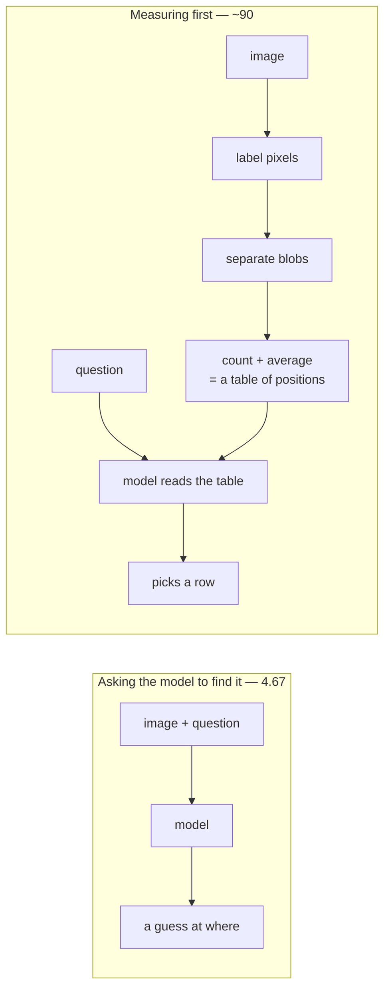
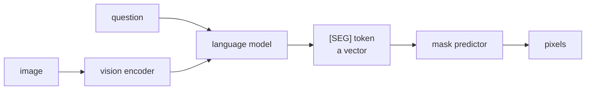

# The research this library is built on

Three papers shaped the design. This page says what each one measured, which
decision it drove, and — just as usefully — which of their ideas we deliberately
did not take.

Everything here is checkable. Table numbers are cited so you can disagree with a
specific claim rather than the whole approach.

---

## 1. RRS-10K — what vision-language models cannot do

[arXiv 2607.24810](https://arxiv.org/abs/2607.24810) · 43 vision-language models
and 9 segmentation models, 20 tasks, remote sensing imagery.

Most benchmark papers report an average. The useful result here is the *shape* of
the failure — which tasks work and which collapse:

| Task | 43-model average | |
|---|---|---|
| Image description | **88.04** | works, narrow spread (75.7–90.9) |
| Hallucination detection | 83.45 | works |
| Change identification | 83.63 | works |
| Area calculation | 57.78 | unreliable |
| Object counting | 40.89 | unreliable |
| Absolute position | 30.05 | broken |
| Distance calculation | 28.68 | broken |
| **Visual grounding** | **4.67** | broken — most open models score 0.00 |
| Referring segmentation | 8.19 oIoU | broken (9 dedicated models) |

The pattern is clean: **describing is solved, measuring and locating are not.**
And it is uniform — a frontier model and a 2B open model fail the same tasks.

### What this library does about it

Every number in the failing half is exactly computable from data you already
have. Area is a pixel count on an equal-area grid. Position is the geotransform.
Distance is subtraction. Slope is a derivative of an elevation grid.

So the design rule is simply: **do not ask.** `measure.mask_area` counts; it does
not estimate. `GridSpec` refuses a geographic CRS rather than returning square
degrees. The model is never in the path of a number.

### The single most useful number in the paper

Compare two framings of the same underlying question:

| Framing | Score |
|---|---|
| "Look at this image and tell me where X is" | **4.67** |
| "Here are positions in text — which is furthest north?" | **~90** |

Same models. Twenty-fold difference. If a position can be measured *before* the
question is asked, measure it and hand over a table.

---

## 2. GeoPix — a decoder worth borrowing, a method worth skipping

[arXiv 2501.06828](https://arxiv.org/abs/2501.06828) · a multimodal model that
extends image-level dialogue to pixel-level segmentation.

> Not to be confused with **GeoPixel** ([arXiv 2501.13925](https://arxiv.org/abs/2501.13925)),
> a different paper by a different group. RRS-10K scores GeoPixel as the best
> referring-segmentation model at 27.31 oIoU.

### What GeoPix does

A language model emits a special `[SEG]` token whose embedding conditions a mask
predictor, which paints the pixels the user described.

The location must survive a trip through a language bottleneck: the model
encodes *where* as a vector, and the predictor decodes it back to ground.

### Why we don't use it

Not because it is bad — because **it needs referring-expression training data,
and most projects do not have any.** GeoPix reports 75–92 mIoU *on the dataset it
was trained on*. RRS-10K's 8.19 is largely zero-shot on unseen scenes. Those are
the same task in two regimes, and without matched training data you are in the
second one.

Measuring positions first needs no new labels at all.

### What we do take — three ablations

These are about the *colouring-in* half of their model, which any segmentation
system still has to do.

**Class-wise memory** (their table IX). A bank of learned shape priors per class,
consulted to refine a coarse mask:

| Memory capacity | mIoU |
|---|---|
| none | 76.56 |
| 32 slots | 80.77 |
| **64 slots** | **84.25** |
| 256 slots | 83.88 |

Capacity saturates at 64. Fusing with a 3D convolution (2.7K parameters) beat
attention (532K) and dual attention (34.6M) on performance per parameter.

**Independent per-scale projectors** (their table X):

| | mIoU | cIoU |
|---|---|---|
| shared projector | 74.65 | 85.31 |
| **independent** | **84.25** | **89.82** |

Roughly ten points for a change that costs nothing.

**Learned weights** for combining feature scales, rather than fixed ones.

### The number that actually justifies the decoder

Their table III, broken out by object size. This is the comparison that matters
for overhead agriculture:

| Method | Small | Medium | Large | Overall |
|---|---|---|---|---|
| PixelLM (retrained) | 66.93 | 85.71 | 93.28 | 78.05 |
| LISA (retrained) | 62.48 | 86.37 | 95.75 | 82.14 |
| **GeoPix** | **75.49** | **92.37** | **96.27** | **84.25** |
| *lead over best alternative* | *+8.56* | *+6.00* | *+0.52* | *+2.11* |

**Read the last row, not the last column.** On large objects it is a tie. On small
objects — under 1% of image area — it is ahead by 8.6 points.

Why: a large object carries thousands of pixels of its own evidence, so a coarse
prediction is already nearly right. A three-pixel-wide ditch has almost none, so
a stored prior about what that class's edges look like supplies most of the
signal.

**Drainage ditches, farm tracks and treelines are all in the small bucket.** If
you are segmenting overhead agriculture, judge a decoder on its small-object
column.

### What else we leave

- **Their two-stage training.** It balances text generation against mask
  prediction — a tension that does not exist when no language model sits inside
  the segmentation path.
- **336×336 input.** At 0.6 m that is a 200 m window, smaller than one field.

---

## 3. Fields of The World — field boundaries at scale

[arXiv 2409.16252](https://arxiv.org/abs/2409.16252) · 76,000+ samples across 27
countries, standardised to the fiboa schema, openly licensed.

Useful as a pretraining source for field-boundary delineation. Two caveats worth
stating before you plan around it:

- **Sentinel-2 at 10 m.** A 3 m ditch is 9% of one pixel — it can only ever be a
  mixed pixel. Fine for field boundaries, useless for anything narrower than
  roughly 30 m.
- **Thin US coverage.** Mostly Europe, Africa, Asia and South America.

---

## How to read all three together

1. **Do not ask a model for a number you can compute.** (RRS-10K)
2. **If you must locate something, measure positions first and let the model read
   them.** (RRS-10K, 4.67 vs ~90)
3. **If you are segmenting small overhead features, use a class-prior memory and
   independent per-scale projectors, and judge on the small-object column.**
   (GeoPix, tables III / IX / X)
4. **Match your imagery resolution to the narrowest thing you need to see,** not
   to what is convenient to download. (FTW's 10 m limit)

See [`ARCHITECTURE.md`](ARCHITECTURE.md) for how these turn into code, and
[`CLASSES.md`](CLASSES.md) for what the segmentation model actually labels.
